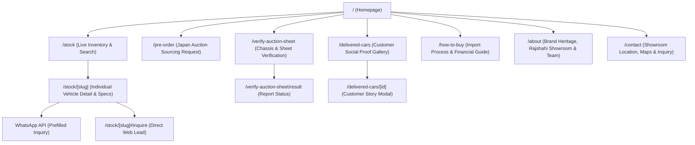

# CAR CHOICE BD — Sitemap & Public Page Specification

> **Document ID:** `CCBD-DOC-02`  
> **Location:** `d:/CarChoice/docs/planning/02-sitemap-and-page-specification.md`  
> **Application:** Public Customer Web Application  
> **Target Audience:** Reconditioned car buyers, corporate fleets, and auto enthusiasts across Bangladesh (with regional pride in Rajshahi).

---

## 1. Master Sitemap & Route Hierarchy

---

## 2. Comprehensive Page-by-Page Technical Specifications

---

### Page 01: Homepage (`/`)

* **Route:** `/`
* **Business Purpose:** Establish luxury brand authority, communicate the 4 trust pillars, showcase Rajshahi showroom anchor location, display featured ready-stock, and route visitors into high-converting discovery funnels.
* **SEO Metadata:**
  * **Title:** `Car Choice BD | Japanese Reconditioned Car Importer in Rajshahi, Bangladesh`
  * **Meta Description:** `Car Choice BD imports authentic, high-grade Japanese reconditioned vehicles to Bangladesh. Explore ready stock, verify auction sheets, and pre-order directly from Japan.`
  * **Open Graph:** Branded `Cover_Photo.png` with official emblem and Toyota fleet.
* **Top-to-Bottom Section Sequence:**
  1. **Top Utility Bar:** Phone hotline (`+880 1838-581250`), WhatsApp quick-chat link, Rajshahi showroom hours (`10:00 AM – 8:00 PM`), social links.
  2. **Global Header / Nav:** Official 3D emblem with "CAR CHOICE BD", navigation links, language toggle (English / বাংলা), "Inquire Now" luxury button.
  3. **Cinematic Hero Section:**
     * High-impact headline: *"Your Trusted Destination for Japanese Reconditioned Vehicles."*
     * Subtitle: *"Direct Japan Auction Sourcing • 100% Verified Auction Sheets • Seamless Delivery in Bangladesh."*
     * Interactive Fast Search Bar: Dropdowns for Make, Model, Year range, and Budget.
     * CTAs: `[Explore Ready Stock (Primary)]` and `[Pre-Order From Japan (Secondary)]`.
     * Subtle ambient vehicle video / photography background.
  4. **4 Trust Pillars (Brand Value Bar):**
     * Certified Quality (Shield Icon)
     * Authentic Auction Grades (Auction Gavel Icon)
     * Direct Import from Japan (Globe Icon)
     * Reliable & Trusted (Handshake Icon)
  5. **Featured Ready-Stock Showcase:**
     * Curated carousel / grid of 6 to 8 top-tier vehicles available immediately at the Rajshahi showroom or port.
     * Filter tabs: `All`, `Hybrid`, `SUV / Crossover`, `Sedan`, `Van / MPV`.
     * Card includes: Photo, Title, Year, Grade badge (e.g. `5/A`), Mileage, BDT Price (or `Call for Price`), WhatsApp button.
  6. **6-Box Core Service Hub (Inspired by Reference Model, Reimagined for Luxury):**
     * 01: **Live Inventory Catalog** (Instant stock lookup)
     * 02: **Direct Japan Auction Sourcing** (Bid on live USS/TAA/CAA cars)
     * 03: **Auction Sheet Verification** (Chassis number inspection)
     * 04: **Customer Delivery Hall of Fame** (Real delivered cars & photos)
     * 05: **Import & Financing Calculator** (Duty, registration & EMI estimator)
     * 06: **Rajshahi Showroom Experience** (Visit us near BRTA Office)
  7. **Japanese Auction Transparency & Verification Callout:**
     * Interactive preview explaining how to read an authentic Japanese auction sheet (Grade S, 5, 4.5, 4; damage map A1/U1/W1).
     * Quick input field: *"Enter Chassis / VIN"* with instant verification CTA.
  8. **About Car Choice BD & Rajshahi Showroom:**
     * Showroom overview located at *Near BRTA Office, Amchattar, Rajshahi, Bangladesh, 6203*.
     * Commitment to zero odometer tampering, genuine auction sheets, and smooth BRTA registration support.
  9. **Delivered Cars Social Proof Carousel:**
     * Real photos of happy vehicle handovers with keys in Bangladesh.
  10. **Global Footer:** Detailed 4-column footer, legal notices, BRTA compliance notice, accepted payment methods (bKash, Bank Transfer, Pay Order).
* **Acceptance Criteria:**
  * Fast First Contentful Paint (< 1.2s on mobile 4G).
  * Fast search bar correctly filters and redirects to `/stock?make=...&budget=...`.
  * WhatsApp button launches WhatsApp chat with pre-filled message.

---

### Page 02: Live Stock Catalog (`/stock`)

* **Route:** `/stock`
* **Business Purpose:** Provide a fast, responsive inventory search engine for buyers and brokers. Supports dual-view: Luxury Card Grid and High-Density Spec Table.
* **SEO Metadata:**
  * **Title:** `Available Japanese Cars in Stock | Car Choice BD Inventory`
  * **Meta Description:** `Search ready stock and port inventory of Japanese reconditioned cars in Bangladesh. Filter by Toyota, Honda, Nissan, auction grade, year, and price.`
* **Key Components & Layout:**
  1. **Top Status Bar:**
     * Active count: *"Showing [X] vehicles available in Rajshahi Showroom & Port"*.
     * View Switcher Toggle: `[Grid View ⊞]` vs `[Table View ☰]`.
     * Sorting Dropdown: *Price: Low to High*, *Price: High to Low*, *Year: Newest*, *Mileage: Lowest*, *Auction Grade: Highest*.
  2. **Filter Sidebar (Desktop Sticky / Mobile Bottom Sheet):**
     * **Keyword:** Live search for Model, Chassis, or Package.
     * **Stock Status:** `Ready in Showroom`, `At Port (Mongla/Chattogram)`, `In Transit (From Japan)`, `Pre-Order Available`.
     * **Make / Brand:** Toyota, Honda, Nissan, Mitsubishi, Mazda, Lexus, Mercedes-Benz, BMW.
     * **Model:** Dynamic dependent dropdown based on selected Make.
     * **Year of Manufacture:** Checkboxes (`2020` to `2026`).
     * **Auction Grade:** `Grade S / 6 (Brand New)`, `Grade 5 (Mint)`, `Grade 4.5 (Superior)`, `Grade 4 (Clean)`, `Grade R (Repaired/Accident)`.
     * **Fuel Type:** `Hybrid / E-Four`, `Octane / Petrol`, `Diesel`, `EV / Plug-in`.
     * **Transmission / Drive:** `Automatic`, `CVT`, `2WD`, `4WD`.
     * **Price Range (BDT):** Interactive slider (e.g. ৳ 20 Lakh to ৳ 1.5 Crore).
     * **Mileage Range (km):** Slider (0 to 80,000 km).
     * Action Buttons: `[Apply Filters]` and `[Reset All]`.
  3. **Visual Grid View (Default):**
     * 3-column responsive card grid.
     * High-res imagery, auction grade pill, mileage, fuel type, transmission, price badge, and direct WhatsApp / View details button.
  4. **Dense Table View (Reference-Inspired Feature):**
     * Clean dark-mode data table: `#`, `Make & Model`, `Year`, `Color`, `Package`, `Auction Grade`, `Mileage`, `Features`, `Status`, `Action`.
     * Instant horizontal scroll on mobile with frozen model column.
  5. **Empty State:**
     * If no cars match: *"No vehicles match your exact criteria. Submit a Pre-Order Request and we will source your dream car directly from Japanese auctions!"* with direct CTA.
* **Acceptance Criteria:**
  * URL query parameters sync dynamically (`/stock?make=Toyota&year=2024&grade=5`).
  * Instant search without full page reloads.

---

### Page 03: Individual Vehicle Detail (`/stock/[slug]`)

* **Route:** `/stock/[slug]` (e.g. `/stock/toyota-harrier-z-leather-2024-axuh80`)
* **Business Purpose:** The definitive decision and conversion page. Delivers full vehicle transparency (specifications, high-res photos, authentic Japanese auction sheet, condition report) and prompts immediate sales contact.
* **SEO Metadata:**
  * **Title:** `[Year] [Make] [Model] [Package] - For Sale in Bangladesh | Car Choice BD`
  * **Structured Data:** Schema.org `Vehicle` / `Product` JSON-LD with price, VIN/chassis, color, odometer, and seller details.
* **Key Components & Layout:**
  1. **Breadcrumbs:** `Home > Inventory > Toyota > Harrier Z Leather Package 2024`
  2. **Vehicle Title & Status Bar:**
     * Primary Heading: `Toyota Harrier Z Leather Package`
     * Sub-meta: `2024 • 12,000 km • 2.5L Hybrid • Grade 5/A • Pearl White`
     * Status Badges: `[Ready Stock in Rajshahi]` + `[Authentic Auction Grade 5]`
  3. **Media Gallery (Left Column, 60% Width):**
     * Main display viewer with zoom and high-definition photography.
     * Thumbnails slider (10 to 20 angles: exterior, interior front/rear, odometer reading, engine bay, trunk, tires).
     * **Dedicated Auction Sheet Thumbnail:** Highlighted with a gold badge: *"Official Japan Auction Sheet"*. Clicking opens a high-res lightbox with verified translation.
  4. **Pricing & Lead Conversion Panel (Right Column, 40% Width - Sticky):**
     * **Price Display:** `৳ 84,50,000 BDT` (or `Call for Price / Negotiable`).
     * **Instant WhatsApp Direct Action:** Large button: `[Chat on WhatsApp with Vehicle ID]`. Clicking opens WhatsApp with: *"Assalamu Alaikum Car Choice BD, I am interested in Toyota Harrier Z (Chassis: AXUH80-1039482) listed at ৳ 84.5L on your website. Is it available for inspection?"*
     * **Direct Hotline:** `[Call Showroom: +880 1838-581250]`.
     * **Quick Inquiry Form:** Compact form with fields: Full Name, Phone Number, City, Message, and `[Send Inquiry]` button.
  5. **Comprehensive Technical Specifications Table:**
     * **Identity:** Chassis / VIN, Engine Model, CC Displacement (`1987 cc` / `2487 cc`), Drive Train (`2WD / 4WD / E-Four`).
     * **Condition:** Auction Grade (`5`), Exterior Grade (`A`), Interior Grade (`A`), Odometer (`12,450 km - Certified Genuine`).
     * **Dimensions & Weight:** Length, Width, Height, Seating Capacity.
  6. **Factory Equipment & Luxury Features Checklist:**
     * Categorized pill tags:
       * *Safety:* ABS, Pre-Crash Safety, Lane Keep Assist, 360 Panoramic Camera, 8 Airbags, Blind Spot Monitor, Radar Cruise Control.
       * *Comfort & Interior:* Full Leather Seats, Heated & Ventilated Seats, Memory Driver Seat, Panoramic Moonroof, JBL Premium Sound System, 12.3" Display, Apple CarPlay / Android Auto, Wireless Charging.
       * *Exterior:* LED Headlights with Adaptive High-Beam, Power Back Door (Kick Sensor), Modellista Aero Bodykit, 19" Alloy Wheels.
  7. **EMI & Loan Estimation Widget (Interactive):**
     * Down payment slider (30% to 70%), Loan tenure (1 to 5 years), Interest rate (9% default), calculated monthly installment estimate with bank financing partners.
  8. **Similar Available Cars:** 3 to 4 related vehicles in matching price or body type.
* **Acceptance Criteria:**
  * Clean semantic HTML and Schema.org markup.
  * WhatsApp CTA includes vehicle-specific URL and chassis reference.

---

### Page 04: Pre-Order / Direct Japan Auction Sourcing (`/pre-order`)

* **Route:** `/pre-order`
* **Business Purpose:** Allow clients to order customized vehicles directly from Japanese auctions (USS, TAA, CAA, JU, ARAI) matching their exact color, grade, trim, and budget.
* **SEO Metadata:**
  * **Title:** `Pre-Order Japanese Cars From Auction | Car Choice BD`
  * **Meta Description:** `Import your custom vehicle directly from Japanese auto auctions with Car Choice BD. Choose model, color, grade, and package with full transparency and lowest import duty.`
* **Key Components & Layout:**
  1. **Hero Section:** *"Source Your Dream Car Directly from Japanese Auto Auctions."*
  2. **How Direct Sourcing Works (5-Step Visual Flow):**
     * *Step 1: Requirement & Budget Consultation*
     * *Step 2: Live Auction Sheet Selection & Bidding*
     * *Step 3: Japanese Yard Inspection & Shipping*
     * *Step 4: Chattogram / Mongla Port Customs Clearance*
     * *Step 5: BRTA Registration & Handover at Rajshahi Showroom*
  3. **Interactive Pre-Order Sourcing Form:**
     * Multi-step structured form:
       * Step 1 (Vehicle Criteria): Desired Make, Model, Minimum Year, Preferred Color, Target Package/Trim, Minimum Auction Grade (`4.0`, `4.5`, `5.0`, `S`).
       * Step 2 (Budget & Timeline): Approximate Budget in BDT Lakhs, Expected Delivery Window (Within 45 days / 60 days / Flexible).
       * Step 3 (Contact & Customer Info): Name, Phone / WhatsApp Number, City/District (e.g. Rajshahi, Dhaka, Bogura, Natore).
       * Action: `[Submit Japan Sourcing Request]`.
  4. **Why Import With Car Choice BD:**
     * Real auction bids, genuine purchase invoices, live port tracking, and zero hidden charges.
* **Acceptance Criteria:**
  * Form validates Bangladeshi phone numbers (`01xxxxxxxxx` or `+8801xxxxxxxxx`).
  * Submissions persist to the secure Admin Dashboard and trigger instant WhatsApp/email notification to sales managers.

---

### Page 05: Japanese Auction Sheet Verification (`/verify-auction-sheet`)

* **Route:** `/verify-auction-sheet`
* **Business Purpose:** Build market trust, protect customers from altered auction sheets, and generate qualified buyer leads by providing an authentic Japanese auction sheet verification service.
* **SEO Metadata:**
  * **Title:** `Instant Japanese Car Auction Sheet Verification in Bangladesh | Car Choice BD`
  * **Meta Description:** `Verify authentic Japanese auction sheets by chassis number. Check genuine odometer reading, accident history, and inspection grades before buying any car in Bangladesh.`
* **Key Components & Layout:**
  1. **Bilingual Hero (English + Bangla):**
     * *"Verify Genuine Japanese Car Auction Sheet by Chassis Number / VIN."*
     * *"গাড়ির চেসিস নম্বর দিয়ে আসল অকশন শিট যাচাই করুন — মিটার টেম্পারিং ও অ্যাক্সিডেন্ট হিস্ট্রি থেকে নিরাপদ থাকুন।"*
  2. **Chassis Lookup Box:**
     * Input: Text field with placeholder `e.g. ZVG13-2035884, AXUH80-1029384, or GP5-3049583`.
     * Explanatory tooltip: How to locate the chassis number on the vehicle registration card or engine bay plate.
     * Service Fee Notice: Clear explanation of verification options (e.g., *Free for Car Choice BD stock; ৳ 800 BDT nominal fee for external vehicle verification*).
     * Action: `[Verify Chassis Now]`.
  3. **Educational Visual Guide: "How to Read an Auction Sheet":**
     * Annotated diagram of a standard Japanese auction sheet (USS / TAA style).
     * Explanation of Auction Grades (`S`, `6`, `5`, `4.5`, `4`, `3.5`, `RA`, `R`).
     * Explanation of Body Marks:
       * `A1, A2, A3` = Scratch (Small to Large)
       * `U1, U2, U3` = Dent
       * `W1, W2, W3` = Wave / Repaired Paintwork
       * `X, XX` = Needs Replacement / Replaced Panel
       * `C1, C2` = Corrosion
  4. **Direct WhatsApp Support:**
     * *"Need immediate verification assistance? Send your chassis number or auction sheet picture directly to our verification hotline on WhatsApp."*
* **Acceptance Criteria:**
  * Handles input sanitation and uppercase formatting.
  * Provides instant status feedback or routes to inquiry resolution.

---

### Page 06: Delivered Cars & Customer Hall of Fame (`/delivered-cars`)

* **Route:** `/delivered-cars`
* **Business Purpose:** Provide visual social proof of satisfied Bangladeshi clients taking delivery of their imported vehicles.
* **Key Components:**
  1. **Header:** *"Delivering Excellence Across Bangladesh — Our Proud Car Owners."*
  2. **Delivery Filter Bar:** Filter by Year (`2026`, `2025`, `2024`), Brand (`Toyota`, `Honda`, `Lexus`), or Delivery City (`Rajshahi`, `Dhaka`, `Rangpur`, `Other`).
  3. **High-Resolution Photo Grid:**
     * Branded celebration photographs showing car owners holding ceremonial keys next to their vehicles.
     * Details: Vehicle Model, Client Name (with consent), Delivery Date, Delivery Location (e.g. *Rajshahi Showroom*).
  4. **Customer Video Testimonials (Phase 2):** Short video clips of handover moments.

---

### Page 07: How to Buy & Import Regulations (`/how-to-buy`)

* **Route:** `/how-to-buy`
* **Business Purpose:** Educate prospective buyers on Bangladesh automotive import policies, BRTA registration procedures, payment terms, and duty structures.
* **Key Components:**
  1. **5-Step Car Buying Guide:** Showroom Ready-Stock Purchase vs. Japan Pre-Order.
  2. **Bangladesh Import Policy Rules:** Explanation of the 5-year age limit rule for imported reconditioned vehicles in Bangladesh (e.g. in 2026, allowable models are 2021–2026).
  3. **Payment & Banking Guidelines:**
     * Showroom booking advance procedures.
     * Bank LC (Letter of Credit) terms for direct importers.
     * Accepted payment channels: Bank Pay Order, Direct Transfer, bKash Merchant.
  4. **BRTA Registration Support:** How Car Choice BD assists clients with hassle-free Rajshahi / Dhaka BRTA registration, fitness, and tax token issuance.
  5. **Frequently Asked Questions (Accordion):**
     * *Can I inspect the car before making full payment?*
     * *How long does customs clearance take at Mongla / Chattogram port?*
     * *What warranty or after-sales support is provided?*

---

### Page 08: About Us & Rajshahi Showroom (`/about`)

* **Route:** `/about`
* **Business Purpose:** Establish trust, highlight the company's roots and physical presence in Rajshahi, and showcase team credentials.
* **Key Components:**
  1. **Brand Story:** Founded on transparency, integrity, and passion for Japanese automotive craftsmanship.
  2. **Strategic Location Anchor:** Detailed profile of the primary showroom located at *Near BRTA Office, Amchattar, Rajshahi, 6203*.
  3. **Core Commitments:** Guaranteed genuine auction grades, 100% legal import documentation, personalized concierge sourcing.
  4. **Showroom Tour & Facility Photos:** High-resolution gallery of the showroom, display area, and customer consultation lounge.

---

### Page 09: Contact Us & Showroom Locator (`/contact`)

* **Route:** `/contact`
* **Business Purpose:** Connect customers directly to sales executives via telephone, WhatsApp, physical showroom visits, and structured email inquiries.
* **Key Components:**
  1. **Direct Communication Cards:**
     * **Hotline & WhatsApp:** `+880 1838-581250`
     * **Email:** `info@carchoicebd.com` / `sales@carchoicebd.com`
     * **Showroom Address:** Near BRTA Office, Amchattar, Rajshahi, Bangladesh, 6203
     * **Opening Hours:** Saturday to Thursday: `10:00 AM – 8:00 PM` | Friday: `3:00 PM – 8:00 PM`
  2. **Interactive Lead Inquiry Form:**
     * Fields: Full Name*, Phone Number*, Email, Subject*, Message*.
     * Client-side validation + honeypot anti-spam protection.
     * Confirmation modal and instant toast notification upon submission.
  3. **Interactive Google Map Embed:**
     * Centered on Amchattar, Rajshahi with custom dark luxury map styling pin for Car Choice BD.

---

## 3. Reference Feature Scope Classification

To ensure an achievable 4-week delivery without schedule overruns, discovered reference features are categorized:

| Feature Discovered on Reference | Priority | Classification | Rationale & Scope Boundary for Car Choice BD |
| :--- | :--- | :--- | :--- |
| **Ready Stock Vehicle Catalog & Filters** | **P0** | **Core MVP** | The absolute primary engine of the business; must be fast, beautiful, and searchable. |
| **Vehicle Detail Page with Gallery & Specs** | **P0** | **Core MVP** | Primary sales conversion page; showcases real photos and specifications. |
| **Direct WhatsApp Lead Generation** | **P0** | **Core MVP** | In Bangladesh, 90%+ of car sales conversations occur over WhatsApp; essential. |
| **Chassis Number Auction Verification Page** | **P0** | **Core MVP** | High-trust differentiator; allows customers to request verification via WhatsApp/form. |
| **Pre-Order / Custom Japan Sourcing Form** | **P0** | **Core MVP** | Core business pillar for sourcing customized auction vehicles. |
| **Secure Admin Inventory Dashboard** | **P0** | **Core MVP** | Staff must be able to add, edit, price, and publish cars without touching code. |
| **Delivered Cars Social Proof Gallery** | **P1** | **Core MVP (Streamlined)** | Essential credibility builder; manageable via admin photo uploads. |
| **How to Buy & FAQ Educational Guide** | **P1** | **Core MVP** | Builds SEO authority and addresses customer hesitations regarding import laws. |
| **Live USS Japanese Auction API Bidding** | **P3** | **Out of Scope (Excluded)** | Requires private Japanese enterprise dealer licensing ($10k+ API bond); reference site merely redirects to a third-party login. |
| **Full Ecommerce Checkout / Online Car Payment** | **P3** | **Out of Scope (Excluded)** | High-ticket automotive transactions (৳ 25L - ৳ 1.5Cr) are never paid via automated web checkout in Bangladesh; booking occurs via bank pay order or showroom visit. |
| **Automated bKash Payment Gateway for ৳850 Auction Sheets** | **P2** | **Phase 2 (Post-MVP)** | In MVP, auction sheet verification requests are captured as qualified leads and verified directly via WhatsApp; dedicated merchant gateway integration to follow in Phase 2. |
