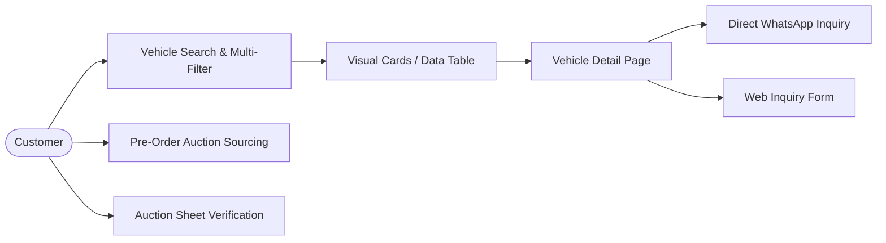

# CAR CHOICE BD — Functional Requirements, Admin Dashboard & User Journeys

> **Document ID:** `CCBD-DOC-03`  
> **Location:** `d:/CarChoice/docs/planning/03-functional-requirements-and-user-journeys.md`  
> **Target Applications:**  
> 1. Public Customer Facing Web Application (`/`)  
> 2. Authenticated Showroom Management Admin Portal (`/admin`)

---

## 1. System Overview & Dual-Application Architecture

Car Choice BD requires two tightly connected application interfaces sharing a single, secure database source of truth:
1. **Public Customer Web Portal:** An ultra-fast, search-engine-optimized, luxury digital showroom designed to captivate buyers, display transparent vehicle data, and drive high-intent sales conversations to WhatsApp and showroom visits.
2. **Secure Admin Dashboard:** A responsive, permissioned management console enabling non-technical showroom staff to create vehicles, upload multi-angle photography, update pricing, track customer inquiries, manage pre-order requests, and archive sold cars without writing code.

---

## 2. Public Website Functional Requirements



### 2.1 Inventory Discovery & Search Engine
* **FR-PUB-01 (Multi-parameter Filtering):** The public catalog must filter active vehicles across 8 simultaneous criteria: Make, Model, Year Range, Fuel Type, Transmission, Auction Grade, Mileage Range, and Price Range.
* **FR-PUB-02 (Live Full-text Search):** Free-text keyword search across vehicle model name, chassis prefix/VIN, and package trim with debounced input (300ms) to prevent server strain.
* **FR-PUB-03 (Dual View Toggle):** Users must be able to switch between a **Luxury Visual Card Grid** (emphasizing exterior photography) and a **Dense Data Table** (emphasizing technical specifications, chassis numbers, and auction grades), retaining the preference in local storage.
* **FR-PUB-04 (URL Query Synchronization):** All filter selections must reflect cleanly in the browser URL (e.g. `/stock?make=Toyota&year=2024&grade=5`) so customers can share exact filtered views via WhatsApp or bookmarks.

### 2.2 Vehicle Showcase & Media Gallery
* **FR-PUB-05 (Multi-Image Lightbox):** Support high-resolution vehicle photo galleries (10–25 photos per car) with thumbnail navigation, swipe gestures on mobile touchscreens, and zoom capabilities.
* **FR-PUB-06 (Japanese Auction Sheet Viewer):** The vehicle detail page must feature a dedicated callout for the authentic Japanese auction sheet with a high-definition modal viewer and inspection mark translations (A1, U1, W1, etc.).
* **FR-PUB-07 (Dynamic Spec Sheet):** Structured tabular display of 20+ vehicle attributes (displacement, chassis, drivetrain, interior/exterior grade, seating, dimensions).
* **FR-PUB-08 (Feature Pill Categorization):** Luxury and safety features grouped visually into tags (e.g. *Panoramic Sunroof*, *360 Bird-Eye Camera*, *Power Back Door*, *Heated Seats*).

### 2.3 Lead Generation & Customer Communication
* **FR-PUB-09 (WhatsApp Deep-Linking):** Every vehicle card and detail page must provide a prominent WhatsApp CTA. Clicking the button must open WhatsApp (desktop or mobile app) with a pre-filled, URI-encoded message containing the vehicle title, year, chassis number, and canonical website URL.
* **FR-PUB-10 (Persistent Mobile Action Bar):** On mobile viewports (`≤ 768px`), a fixed bottom navigation bar must anchor two primary actions: `[📞 Call Hotline]` and `[💬 WhatsApp Sales]`, guaranteeing zero friction for instant customer contact.
* **FR-PUB-11 (Web Inquiry Forms):** Embedded inquiry forms on Vehicle Detail, Pre-Order, and Contact pages with client-side validation, anti-spam honeypot fields, and instant success confirmation toasts.

---

## 3. Secure Admin Dashboard Functional Requirements

The administrative portal (`/admin`) is designed for operational speed, data integrity, and non-technical staff usability.

```mermaid
graph TD
    Admin([Showroom Staff]) --> Login[/admin/login]
    Login --> AuthCheck{Valid Session & Role?}
    AuthCheck -- No --> Deny[403 Forbidden]
    AuthCheck -- Yes --> Dashboard[/admin/dashboard]
    Dashboard --> VehMgmt[/admin/vehicles]
    Dashboard --> InqMgmt[/admin/inquiries]
    Dashboard --> PreMgmt[/admin/pre-orders]
    Dashboard --> DelivMgmt[/admin/delivered-cars]
    Dashboard --> Settings[/admin/settings]
```

### 3.1 Authentication & Role-Based Access Control (RBAC)
* **FR-ADM-01 (Secure Authentication):** Admin portal accessible only via encrypted HTTPS sessions with email/password authentication backed by Supabase Auth / Secure Session Tokens.
* **FR-ADM-02 (Staff Role Hierarchy):**
  * **Super Admin / Owner:** Full access to all modules, user account creation, system settings, analytics, and record deletion.
  * **Inventory Manager:** Add, edit, publish, reserve, sell, and archive vehicles; upload photos; edit specifications. Cannot delete user accounts.
  * **Sales Executive:** View inventory; view, assign, add notes to, and update the status of customer inquiries and pre-order requests. Read-only inventory access.
* **FR-ADM-03 (Session Timeout & Password Recovery):** Automatic session invalidation after period of inactivity and secure email password reset flow.

### 3.2 Vehicle & Inventory Lifecycle Management
* **FR-ADM-04 (Vehicle Creation & Edit):** Form-based data entry with structured dropdowns for standard Japanese makes and models (preventing typos) and free-text overrides for rare trims.
* **FR-ADM-05 (Dual Status State Machine):**
  * **Publication Status:** `Draft` (visible only to admin), `Published` (live on customer website), `Archived` (hidden from website but retained in business history).
  * **Inventory Status:** `Ready Stock (Showroom)`, `In Transit (Port / Mongla / Chattogram)`, `Available for Pre-Order`, `Reserved / Booked`, `Sold`.
* **FR-ADM-06 (Multi-Image Drag-and-Drop Uploader):**
  * Support batch photo uploads (up to 30 images per vehicle).
  * Automatic client-side compression before upload to reduce bandwidth.
  * Drag-and-drop reordering to set the primary featured cover image.
  * Dedicated toggle to flag an image as the "Official Japanese Auction Sheet".
* **FR-ADM-07 (Bespoke Pricing Configuration):**
  * Numeric cash price in BDT (e.g. `8450000`).
  * Display toggle: `[Show Exact Price]` vs `[Display 'Call for Price']` vs `[Negotiable]`.

### 3.3 Customer Lead & Inquiry Management
* **FR-ADM-08 (Unified Inquiry Inbox):** Consolidated list of all leads originating from the website (Vehicle Inquiries, General Contact, Pre-Order Requests, and Auction Verification checks).
* **FR-ADM-09 (Inquiry Lifecycle Tracking):**
  * Status flags: `New Lead`, `Contacted (WhatsApp/Call)`, `Showroom Visit Scheduled`, `Negotiation / Booking`, `Closed Won (Purchased)`, `Closed Lost (Spam/Unreachable)`.
  * Internal staff notes: Staff can append internal notes (e.g. *"Customer visited Amchattar showroom on Oct 18; interested in White Harrier"*).

### 3.4 Delivered Cars Social Proof Manager
* **FR-ADM-10 (Delivery Record Creation):** Upload delivery celebration photos, record vehicle model, delivery city, customer name (with consent flag), and display order on `/delivered-cars`.

---

## 4. End-to-End User Journeys & Workflows

---

### Journey 01: Customer Discovers Stock & Inquires via WhatsApp

* **Actor:** Prospective car buyer in Rajshahi looking for a hybrid SUV.
* **Goal:** Verify vehicle specifications and negotiate price via WhatsApp.
* **Flow:**
  1. Customer visits `carchoicebd.com` on a smartphone.
  2. Taps "Explore Ready Stock" on Homepage hero.
  3. Applies filters: Make = `Toyota`, Fuel = `Hybrid`, Status = `Ready Stock`.
  4. Selects *Toyota Corolla Cross Z 2024*.
  5. Reviews the 15-photo gallery, inspects the Japanese Auction Sheet (Grade 5, clean panels), and notes the chassis number.
  6. Taps `[Chat on WhatsApp]` in the sticky bottom bar.
  7. Mobile OS launches WhatsApp with pre-filled text: *"Assalamu Alaikum Car Choice BD, I am interested in Toyota Corolla Cross Z 2024 (Chassis: ZVG13-2035884) listed on your website. Is it available for inspection at your Rajshahi showroom?"*
  8. Sales executive receives the message with instant vehicle context and replies immediately.
* **Success Outcome:** Immediate qualified showroom lead generated without data entry friction.

---

### Journey 02: Customer Requests Custom Japan Auction Sourcing (Pre-Order)

* **Actor:** Executive looking for a specific Pearl White Lexus NX350h or Toyota Alphard not in local stock.
* **Goal:** Commission Car Choice BD to source and import the car from Japan.
* **Flow:**
  1. Customer navigates to `/pre-order`.
  2. Reads the transparent 5-step sourcing process and Bangladesh import regulations.
  3. Fills the Pre-Order Form:
     * Make: `Toyota` | Model: `Alphard Executive Lounge` | Year: `2023+` | Color: `Pearl White`
     * Target Auction Grade: `5 or S`
     * Budget: `৳ 1.8 Crore`
     * Name, Phone Number, City: `Rajshahi`
  4. Submits form.
  5. Website validates phone number, displays confirmation modal, and triggers toast notification.
  6. Server saves inquiry into `pre_order_requests` database table and sends notification alert to sales manager.
  7. Customer receives instant WhatsApp confirmation from the sales desk acknowledging the sourcing request.
* **Success Outcome:** High-ticket procurement contract initiated with complete requirements recorded.

---

### Journey 03: Administrator Publishes a New Vehicle Arrival

* **Actor:** Inventory Manager at Rajshahi showroom.
* **Goal:** Publish a newly arrived Toyota Harrier to the website within 2 minutes.
* **Flow:**
  1. Admin logs into `carchoicebd.com/admin` using two-factor/email credentials.
  2. Clicks `[+ Add Vehicle]`.
  3. Selects Make (`Toyota`) from dropdown; types Model (`Harrier`) and Trim (`Z Leather Package`).
  4. Inputs technical specs: Year (`2024`), Chassis (`AXUH80-1094821`), Engine (`2500 cc`), Mileage (`8,500 km`), Color (`Precious Black Pearl`), Fuel (`Hybrid`).
  5. Sets Auction Point (`Grade 5`), Interior (`A`), Exterior (`A`).
  6. Drags and drops 18 vehicle photographs taken in the showroom.
  7. Marks image #1 as primary cover photo; marks image #2 as "Auction Sheet".
  8. Enters price: `84,50,000` BDT and sets display to `[Show Exact Price]`.
  9. Sets Inventory Status to `Ready Stock (Showroom)` and Publication Status to `Published`.
  10. Clicks `[Save & Publish]`.
  11. The vehicle appears immediately on the public `/stock` catalog and homepage featured reel without manual code edits or redeployment.
* **Success Outcome:** New arrival goes live instantly with full media and specifications.

---

### Journey 04: Administrator Reserves or Sells a Vehicle

* **Actor:** Sales Manager after receiving booking deposit.
* **Goal:** Mark a vehicle as Reserved or Sold so other buyers know it is taken.
* **Flow:**
  1. Admin searches chassis or model in `/admin/vehicles`.
  2. Clicks `Edit` on the vehicle record.
  3. Changes Inventory Status from `Ready Stock` to `Reserved / Under Booking` (or `Sold`).
  4. Clicks `[Update Status]`.
  5. On the public website:
     * The vehicle card displays an elegant `[RESERVED]` or `[SOLD]` badge overlay.
     * The WhatsApp CTA shifts to *"Inquire About Similar Vehicles"* so customer interest is not lost.
* **Success Outcome:** Real-time stock transparency prevents customer frustration and double-booking.

---

### Journey 05: Customer Submits Website Inquiry & Admin Follows Up

* **Actor:** Prospective buyer browsing late at night.
* **Goal:** Send inquiry via website form without calling immediately.
* **Flow:**
  1. Customer fills out "Quick Inquiry Form" on vehicle page:
     * Name: `Rafiqul Islam` | Phone: `01712xxxxxx` | City: `Bogura`
     * Message: *"Can you arrange delivery to Bogura, and what is the bank loan facility?"*
  2. Customer clicks `[Submit Inquiry]`.
  3. System validates fields, writes record to `inquiries` table with status `New Lead`.
  4. Next morning, Sales Executive opens `/admin/inquiries`, filters by `Status = New Lead`.
  5. Clicks on Rafiqul's record, views vehicle reference, and taps the one-click `[Open in WhatsApp]` button in the admin panel to initiate chat.
  6. Changes lead status to `Contacted` and writes note: *"Sent loan terms via WhatsApp; waiting for bank statement"*.
* **Success Outcome:** Zero lead leakage and full internal audit trail of customer communication.

---

### Journey 06: Customer Navigates via Low-End Mobile Device

* **Actor:** Commuter browsing on an entry-level smartphone over 4G mobile data.
* **Goal:** Smooth, responsive vehicle browsing without lag or crashes.
* **Flow:**
  1. Customer loads homepage; lightweight static shell renders in < 1.2s.
  2. Heavy decorative animations are automatically disabled via `prefers-reduced-motion` or mobile viewport detection.
  3. Tap on hamburger menu smoothly slides out a dark frosted drawer with links to Stock, Verify Auction Sheet, Delivered Cars, and Showroom Location.
  4. Browses vehicle cards rendered with responsive WebP images sized to screen width (390px, ~40KB per image).
  5. Fixed bottom bar remains accessible at all times without obscuring content.
* **Success Outcome:** Frictionless mobile browsing with fast load times and accessible touch targets.

---

## 5. WhatsApp vs. Website Inquiry Handling Boundary

To ensure complete technical clarity and realistic client expectations:

> [!IMPORTANT]
> **Explicit Architectural Distinction: WhatsApp vs. Web Form Leads**
> 
> * **Direct WhatsApp Conversations:**  
>   When a user clicks *"Chat on WhatsApp"*, they are deep-linked directly to the official business WhatsApp app (`wa.me/+8801838581250`).  
>   **These messages DO NOT automatically appear inside the custom admin dashboard** unless an enterprise WhatsApp Business Cloud API with webhook infrastructure ($$$ monthly licensing) is implemented.  
>   For the 4-week MVP, WhatsApp conversations remain inside the showroom staff's official WhatsApp Business mobile/desktop application.
> 
> * **Website Inquiry Form Submissions:**  
>   Submissions made via website forms (Contact form, Pre-order form, Vehicle inquiry form) **DO save directly into the Postgres/Supabase database** and are managed inside `/admin/inquiries`.  
>   The admin panel provides a convenient `[Quick Reply via WhatsApp]` button next to each inquiry that opens a pre-composed WhatsApp chat to the customer's phone number.

---

## 6. Testable Acceptance Criteria Matrix

| Module | Requirement ID | Test Scenario | Expected Result | Pass / Fail Condition |
| :--- | :--- | :--- | :--- | :--- |
| **Search** | `AC-PUB-01` | Filter by `Toyota` + `Year 2024` + `Hybrid` | Only vehicles matching all three parameters are displayed. | Pass if result set matches DB query; 0 non-matching rows. |
| **WhatsApp** | `AC-PUB-02` | Click WhatsApp button on vehicle detail page | URL opens `https://wa.me/8801838581250?text=...` with valid chassis and vehicle title. | Pass if message includes correct vehicle parameters. |
| **Security** | `AC-ADM-01` | Attempt unauthenticated direct navigation to `/admin/vehicles` | System intercepts request and redirects to `/admin/login`. | Pass if 0 data leaked; 302/307 redirect issued. |
| **Media** | `AC-ADM-02` | Upload 15 high-res vehicle photos in Admin | Images compressed, uploaded to storage bucket, and URLs saved to DB array. | Pass if gallery displays all 15 images on public detail page. |
| **Validation** | `AC-PUB-03` | Submit contact form with invalid phone `12345` | Form displays inline error: "Please enter a valid 11-digit Bangladeshi mobile number". | Pass if submission blocked until valid format entered. |
| **Responsiveness**| `AC-PUB-04` | View site at `390px` viewport width | No horizontal overflow scroll; bottom action bar sticky and functional. | Pass if horizontal scrollbar absent and touch targets ≥ 44×44px. |
