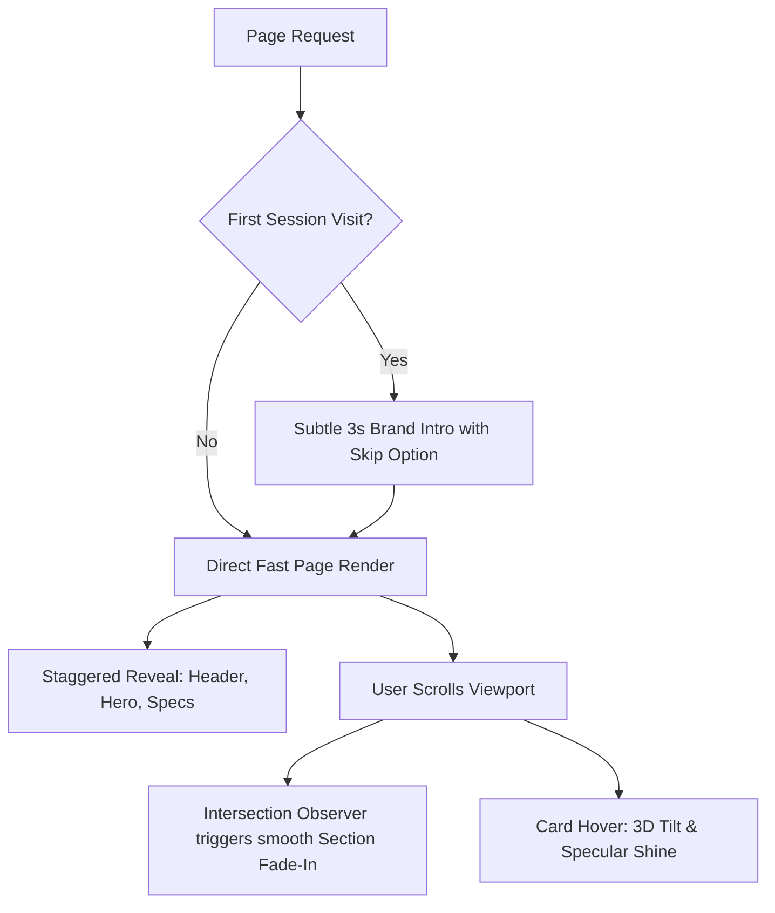

# CAR CHOICE BD — Brand Identity, Design System & Motion Specification

> **Document ID:** `CCBD-DOC-04`  
> **Brand:** Car Choice BD  
> **Location:** `d:/CarChoice/docs/planning/04-brand-design-and-motion-system.md`  
> **Status:** Finalized Architectural Direction  
> **Visual Benchmark:** High-End Automotive Luxury (Mercedes-Maybach, Lexus VIP, Aston Martin bespoke digital experiences)

---

## 1. Design Philosophy: "Cinematic Dark Luxury"

Car Choice BD is not a commodity used-car lot; it is a premier importer of authentic Japanese reconditioned motor vehicles for high-net-worth individuals, executives, and discerning families in Bangladesh.

The visual system must establish **immediate authority, technical transparency, and prestige**. It balances:
1. **Deep Architectural Darkness:** Midnight navy and near-black surfaces create a showroom environment where vehicle paintwork, metallic finishes, and headlights gleam.
2. **Liquid Chrome & Metallic Silver:** Direct physical homage to the official 3D interlocking emblem.
3. **Restrained Warm Gold:** Chamfered edge lines, VIP badges, and auction grade indicators (`#D4AF37`).
4. **Subtle Crimson Accents:** Sporty precision accents (`#E53935`) echoing the official signature "Drive Excellence".
5. **Disciplined Glassmorphism:** Translucent frosted acrylic panels over dark backdrops to create realistic optical depth without compromising legibility or performance.

---

## 2. Color System & Design Tokens

All tokens are defined in HSL and Hex with explicit semantic roles:

```css
:root {
  /* =========================================
     1. BACKGROUND & CANVAS TOKENS
     ========================================= */
  --bg-primary: #070B14;       /* Deepest Midnight Void (Page background) */
  --bg-secondary: #0B111E;     /* Midnight Navy (Section alternating background) */
  --bg-tertiary: #101827;      /* Slate Navy (Elevated cards & modals) */
  --bg-surface: #141E33;       /* Interactive element resting background */

  /* =========================================
     2. METALLIC & CHROME TOKENS (Silver Material)
     ========================================= */
  --metal-silver-100: #F8FAFC; /* Specular highlight / Pure metallic glint */
  --metal-silver-200: #E2E8F0; /* Primary metallic text & high-contrast labels */
  --metal-silver-300: #CBD5E1; /* Secondary metallic subtitle */
  --metal-silver-400: #94A3B8; /* Muted metallic captions / spec units */
  --metal-silver-500: #64748B; /* Deactivated chrome / icon stroke */
  --metal-silver-gradient: linear-gradient(135deg, #FFFFFF 0%, #CBD5E1 50%, #94A3B8 100%);
  --metal-chrome-reflection: linear-gradient(180deg, rgba(255,255,255,0.25) 0%, rgba(255,255,255,0.02) 100%);

  /* =========================================
     3. RESTRAINED GOLD ACCENTS (Warm Luxury)
     ========================================= */
  --gold-primary: #D4AF37;     /* Classic Champagne Gold (Verified badges, Grade 5/S) */
  --gold-light: #F3E5AB;       /* Soft gold glow / hover tint */
  --gold-dark: #997A15;        /* Beveled shadow edge */
  --gold-gradient: linear-gradient(135deg, #F3E5AB 0%, #D4AF37 50%, #AA7C11 100%);

  /* =========================================
     4. SPORT CRIMSON ACCENTS (Motto / Urgency)
     ========================================= */
  --crimson-primary: #E53935;  /* Sport Crimson (Drive Excellence accent, Live Badges) */
  --crimson-hover: #D32F2F;    /* Button hover state */
  --crimson-glow: rgba(229, 57, 53, 0.35);

  /* =========================================
     5. DIRECT COMMUNICATION CHANNELS
     ========================================= */
  --whatsapp-primary: #25D366; /* Official WhatsApp Green */
  --whatsapp-dark: #1EBE5D;    /* WhatsApp button active state */
  --whatsapp-glow: rgba(37, 211, 102, 0.35);

  /* =========================================
     6. GLASSMORPHISM & TRANSLUCENT SURFACES
     ========================================= */
  --glass-surface-subtle: rgba(16, 24, 40, 0.65);
  --glass-surface-medium: rgba(20, 30, 51, 0.82);
  --glass-surface-dense: rgba(11, 17, 30, 0.94);
  --glass-border-subtle: rgba(255, 255, 255, 0.08);
  --glass-border-metal: rgba(226, 232, 240, 0.22);
  --glass-border-gold: rgba(212, 175, 55, 0.35);
  --glass-blur-sm: 8px;
  --glass-blur-md: 16px;
  --glass-blur-lg: 24px;
}
```

---

## 3. Typography System

To mirror the official beveled logo typography, we employ a high-end dual-font architecture:

### 3.1 Font Families
* **Display / Headings:** **`Outfit`** or **`Cinzel` / `Playfair Display`** (Google Fonts).
  * *Default Production Choice:* **`Outfit`** (Weights: 500, 600, 700) with letter-spacing tracking (`+0.02em` to `+0.05em`). Provides a modern, ultra-clean aesthetic reminiscent of Aston Martin and Porsche digital interfaces.
  * *Brand Crest & Special Quotes:* **`Cinzel`** (for "DRIVE EXCELLENCE" and luxury heritage callouts).
* **Body / Technical Data:** **`Plus Jakarta Sans`** or **`Inter`** (Weights: 400, 500, 600, 700).
  * Exceptional legibility on dark backgrounds, high x-height, and crystal-clear tabular figures for chassis numbers, mileage figures, and pricing in BDT.

### 3.2 Type Scale

| Level | Size (px / rem) | Line Height | Weight | Letter Spacing | Semantic Usage |
| :--- | :--- | :--- | :--- | :--- | :--- |
| **Hero Display** | `56px` / `3.5rem` (Desktop)<br>`36px` / `2.25rem` (Mobile) | 1.1 | 700 Bold | `-0.02em` | Homepage Hero title, primary value statement |
| **H1 Section** | `40px` / `2.5rem` | 1.2 | 700 Bold | `-0.01em` | Major page headings (Live Inventory, Auction Verification) |
| **H2 Section Sub** | `28px` / `1.75rem` | 1.3 | 600 SemiBold | `0.00em` | Vehicle names on Detail Page, section headers |
| **H3 Component** | `20px` / `1.25rem` | 1.4 | 600 SemiBold | `+0.01em` | Vehicle card titles, modal headings, filter group headers |
| **Body Large** | `18px` / `1.125rem` | 1.6 | 400 Regular | `0.00em` | Hero lead paragraphs, about company introduction |
| **Body Regular** | `15px` / `0.9375rem` | 1.6 | 400 Regular | `0.00em` | General copy, specifications values, FAQ answers |
| **Technical / Meta** | `13px` / `0.8125rem` | 1.5 | 500 Medium | `+0.03em` | Chassis numbers, auction point pills, table headers |
| **Micro Caption** | `11px` / `0.6875rem` | 1.4 | 600 SemiBold | `+0.06em` (Uppercase) | Status badges, category breadcrumbs, copyright |

---

## 4. Spacing, Layout & Elevation Rules

### 4.1 Container & Grid Standards
* **Max Container Width:** `1360px` (Desktop content constraint).
* **Sidebar + Content Grid:** `300px` sticky filter rail + `1fr` flexible data/card stream.
* **Gutters:**
  * Desktop: `32px` (`2rem`)
  * Tablet: `24px` (`1.5rem`)
  * Mobile: `16px` (`1rem`)

### 4.2 Border Radius System
* **Badges & Pills:** `9999px` (Full round pill)
* **Buttons & Inputs:** `8px` (Refined, architectural precision; avoid bubble-gum curves)
* **Cards & Containers:** `14px`
* **Modal Dialogs:** `18px`

### 4.3 Realistic Elevation & Specular Lighting
Dark mode depth is achieved through **light reflection on edges**, not pitch-black drop shadows:
* **Card Rest:**  
  `box-shadow: 0 4px 20px rgba(0, 0, 0, 0.4), inset 0 1px 0 rgba(255, 255, 255, 0.08);`
* **Card Hover:**  
  `box-shadow: 0 12px 36px rgba(0, 0, 0, 0.6), 0 0 15px rgba(212, 175, 55, 0.15), inset 0 1px 0 rgba(255, 255, 255, 0.2);`
* **Floating Bar:**  
  `box-shadow: 0 -4px 24px rgba(0, 0, 0, 0.7), inset 0 1px 0 rgba(255, 255, 255, 0.1);`

---

## 5. UI Component Design Specifications

### 5.1 Buttons
1. **Primary Luxury CTA (Gold/Chrome Shimmer):**
   * Background: Solid deep gold gradient (`var(--gold-gradient)`) or solid dark slate with liquid chrome border.
   * Text: `#070B14` (Deep navy/black) for high contrast and legibility.
   * Hover: Scale `1.02`, subtle gold ambient glow (`box-shadow: 0 0 20px rgba(212, 175, 55, 0.4)`).
2. **WhatsApp Action CTA:**
   * Background: `var(--whatsapp-primary)` (`#25D366`).
   * Text: `#FFFFFF` bold with official WhatsApp icon SVG.
   * Hover: Scale `1.02`, shadow glow (`var(--whatsapp-glow)`).
3. **Secondary Filter / Outline Button:**
   * Background: `rgba(255, 255, 255, 0.03)`.
   * Border: `1px solid var(--glass-border-metal)`.
   * Text: `var(--metal-silver-200)`.
   * Hover: `background: rgba(255, 255, 255, 0.08)`.

### 5.2 Vehicle Cards (Visual Mode)
* **Top Area:** 16:9 high-res vehicle photography with subtle zoom on hover (`scale(1.05)` over 400ms).
* **Overlay Badges:**
  * Top Left: Stock Status (e.g. `READY STOCK` in green pill, `IN TRANSIT / PORT` in gold pill, `PRE-ORDER` in cyan pill).
  * Top Right: Japanese Auction Point (e.g. `GRADE 5` or `GRADE S` with gold star/gavel icon).
* **Body:**
  * Model Title (e.g. `Toyota Harrier Z Leather Package`).
  * Sub-meta: Year (`2024`), Mileage (`12,000 km`), Engine (`2.0L Hybrid`).
  * Chassis Prefix (`AXUH80-xxxxxxx`).
* **Bottom Bar:**
  * Price: Displayed in Bangladeshi Taka (e.g. `৳ 84,50,000` or `Call for Price / Negotiable`).
  * Actions: Dual buttons: `[Details]` and `[WhatsApp Direct Inquiry]`.

### 5.3 Vehicle Data Table (Catalog Mode)
* Dark translucent row with subtle bottom separator.
* Alternating row tint (`rgba(255, 255, 255, 0.015)`).
* Row hover state: highlight with `rgba(212, 175, 55, 0.06)` and left gold border line indicator (`3px solid var(--gold-primary)`).

---

## 6. Motion Design System & Animation Timings

Animation on Car Choice BD must communicate **mechanical precision and luxury**, never frivolous or distracting movement.



### 6.1 Animation Inventory & Triggers

| Component / Interaction | Animation Type | Duration | Easing Function | Mobile Adaptation | Accessibility (`prefers-reduced-motion`) |
| :--- | :--- | :--- | :--- | :--- | :--- |
| **Brand Intro / Splash** | Video fade-in with SVG glow mask | 3.0s auto-exit (or instant click) | `cubic-bezier(0.16, 1, 0.3, 1)` | Disabled on mobile cellular connections; instant render | **Completely bypassed** (direct render of content) |
| **Sticky Header Compress** | Height transition (`80px` → `64px`) + backdrop blur increase | 250ms | `ease-out` | Same behavior | No movement; instant opacity switch |
| **Hero Title & Elements** | TranslateY (`20px` → `0px`) + Opacity (`0` → `1`) | 600ms (staggered 100ms) | `cubic-bezier(0.2, 0.8, 0.2, 1)` | Same behavior | Instant appearance (`opacity: 1`) |
| **Vehicle Grid Stagger** | Cascade reveal of cards (`translateY: 24px`) | 400ms per card (stagger 60ms) | `cubic-bezier(0.25, 1, 0.5, 1)` | Stagger reduced to 30ms | Instant render without delay |
| **Card Hover Feedback** | Subtle scale (`1.015`) + Gold border brightness | 250ms | `ease-out` | Disabled (touch tap instead) | Scale disabled; color change only |
| **Auction Sheet Zoom** | Lightbox modal scale (`0.95` → `1.0`) with backdrop blur | 200ms | `cubic-bezier(0.16, 1, 0.3, 1)` | Fullscreen touch pinch-to-zoom | Instant overlay without scale |

### 6.2 Recommended Animation Implementation Stack
* **Recommendation:** **Tailwind CSS + Vanilla CSS Transitions + Framer Motion (or Motion One)**.
* **Why Motion One / Lightweight Framer Motion:**
  * Clean declarative syntax for React/Next.js.
  * GPU-accelerated hardware transforms (`transform: translate3d`, `opacity`, `backdrop-filter`).
  * Zero layout recalculation or jank.
  * Native support for `useReducedMotion()`.

---

## 7. Responsive Layout Principles

1. **Desktop (`≥ 1280px`):**
   * High-definition car photography, side-by-side spec comparisons, persistent filter rail, instant search.
2. **Tablet (`768px – 1279px`):**
   * Filter drawer collapses into an accessible slide-over sheet.
   * Vehicle cards adapt to a clean 2-column grid.
3. **Mobile (`≤ 767px`):**
   * **Thumb-Zone Optimization:** Critical controls are anchored at the bottom of the screen.
   * **Sticky Bottom Conversion Bar:** Permanent floating bar containing:
     * `[📞 Call Hotline]` (+880 1838-581250)
     * `[💬 WhatsApp Sales]` (pre-filled with car details)
   * Top header is slimmed down (`56px`) with clear hamburger menu revealing full sitemap, location map, and auction verification.
