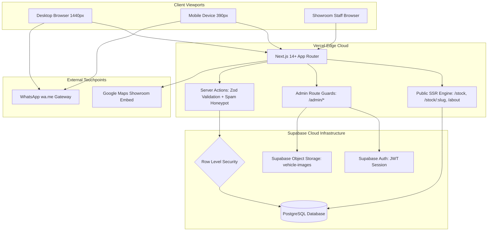
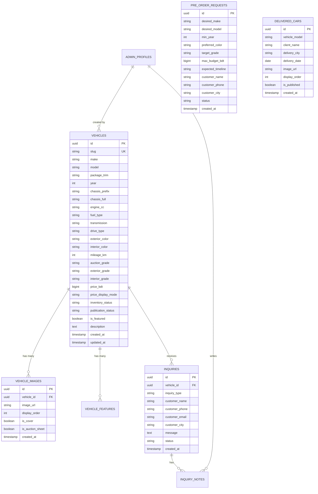

# CAR CHOICE BD — Technical Architecture, Data Model & Security Specification

> **Document ID:** `CCBD-DOC-05`  
> **Location:** `d:/CarChoice/docs/planning/05-technical-architecture-and-data-model.md`  
> **Target Audience:** Engineering, Product Architecture & Implementation Team  
> **Primary Objective:** Enterprise-grade reliability, SEO excellence, beginner developer maintainability, and rapid 4-week delivery.

---

## 1. Technical Evaluation & Stack Recommendation

Choosing the right technology stack requires balancing **search engine indexing (SEO)**, **admin dashboard security**, **media storage costs**, and **developer learning curve**.

### 1.1 Frontend Framework: Next.js (App Router) vs. Vite SPA

| Evaluation Dimension | Next.js (App Router + React + TypeScript) | Vite SPA (Client-Side React) | Architectural Decision |
| :--- | :--- | :--- | :--- |
| **Search Engine Optimization (SEO)** | **Superior:** Native Server-Side Rendering (SSR) and Static Generation (SSG/ISR). Vehicle pages render complete HTML and Schema.org metadata for Googlebot. | **Poor:** Client-side JavaScript rendering; social media crawlers (WhatsApp, Facebook) cannot preview dynamic car images. | **Next.js is Mandatory:** Car Choice BD relies on buyers sharing vehicle links over WhatsApp and searching models on Google. |
| **Routing & Layouts** | Built-in file-system routing, nested layouts for `/` and `/admin`. | Requires `react-router-dom` configuration and manual code splitting. | **Next.js** provides out-of-the-box layout isolation. |
| **Backend & Server Actions** | Built-in API route handlers and React Server Actions for secure database mutations. | Requires deploying a separate backend server (Node.js/Express). | **Next.js** eliminates the need for managing two distinct hosting environments. |
| **Learning Curve** | Modern, well-documented conventions; easy for beginners using standard patterns. | Simpler initial setup, but complexity explodes when adding auth, SSR, and API integration. | **Next.js** provides a unified codebase. |

* **Final Decision:** **Next.js 14+ (App Router) with TypeScript and Tailwind CSS**.

---

### 1.2 Backend & Database: Supabase (Managed PostgreSQL) vs. Custom Express Server

| Evaluation Dimension | Supabase (Managed PostgreSQL) | Custom Node.js / Express + Mongo/Postgres | Architectural Decision |
| :--- | :--- | :--- | :--- |
| **Delivery Speed (4-Week MVP)** | **Instant:** Complete Postgres DB, Auth, Object Storage, and Auto-generated APIs available on Day 1. | **High Overhead:** 2–3 weeks wasted writing boilerplate auth, JWT handling, migrations, and CRUD routes. | **Supabase is the Clear Winner.** |
| **Security & Privacy** | **Bank-Grade:** PostgreSQL Row Level Security (RLS) policies enforce data isolation at the database engine level. | Depends entirely on custom middleware; high risk of authorization bypass bugs. | **Supabase RLS** guarantees customer leads are never exposed to public APIs. |
| **Image Storage** | Integrated S3-compatible Object Storage with CDN and image transforms. | Requires configuring external AWS S3 or Cloudflare R2 buckets manually. | **Supabase Storage** seamlessly links files to database tables. |
| **Cost** | Generous Free Tier (500MB DB, 1GB Storage, 50,000 MAU) — perfectly covers MVP. | Requires dedicated VPS (DigitalOcean/Linode) costing $10–$20/month from day one. | **Supabase Free Tier** minimizes client operational costs. |

* **Final Decision:** **Supabase (Managed PostgreSQL + Supabase Auth + Supabase Storage)**.

---

## 2. Master System Architecture Diagram



---

## 3. Relational Database Schema & Data Model

The data model uses PostgreSQL conventions with UUID primary keys, foreign key constraints, automatic timestamps, and strict column typing.



### 3.1 Table Definition: `vehicles`
* **`id`** (`UUID`, PK, `default gen_random_uuid()`): Unique vehicle identifier.
* **`slug`** (`VARCHAR(255)`, UNIQUE, INDEXED): URL slug (e.g. `toyota-harrier-z-2024-axuh80-1284`).
* **`make`** (`VARCHAR(50)`, NOT NULL): Automotive manufacturer (Toyota, Honda, Nissan, Lexus, etc.).
* **`model`** (`VARCHAR(100)`, NOT NULL): Model name (Harrier, Corolla Cross, Prado, Vezel, Noah).
* **`package_trim`** (`VARCHAR(100)`): Factory grade/package (Z Leather, G, Modello, Spada, RS).
* **`year`** (`SMALLINT`, NOT NULL): Year of manufacture (e.g. `2024`).
* **`chassis_prefix`** (`VARCHAR(50)`, NOT NULL): Chassis model prefix (e.g. `AXUH80`, `ZVG13`).
* **`chassis_full`** (`VARCHAR(100)`): Full chassis number (private/admin or public verification).
* **`engine_cc`** (`VARCHAR(20)`): Engine displacement (e.g. `1987 cc`, `2487 cc`).
* **`fuel_type`** (`VARCHAR(30)`, NOT NULL): `Hybrid`, `Petrol / Octane`, `Diesel`, `Electric`.
* **`transmission`** (`VARCHAR(30)`): `Automatic`, `CVT`, `e-CVT`, `Manual`.
* **`drive_type`** (`VARCHAR(20)`): `2WD (FWD)`, `4WD`, `E-Four (AWD)`.
* **`exterior_color`** (`VARCHAR(50)`): Pearl White, Attitude Black, Gunmetal Silver, etc.
* **`interior_color`** (`VARCHAR(50)`): Black Leather, Burgundy, Tan, Fabric.
* **`mileage_km`** (`INTEGER`, NOT NULL): Certified odometer reading in kilometers (e.g. `12450`).
* **`auction_grade`** (`VARCHAR(10)`, NOT NULL): `S`, `6`, `5`, `4.5`, `4`, `3.5`, `RA`, `R`.
* **`exterior_grade`** (`VARCHAR(5)`): `A`, `B`, `C`, `D`.
* **`interior_grade`** (`VARCHAR(5)`): `A`, `B`, `C`, `D`.
* **`price_bdt`** (`BIGINT`): Cash price in Bangladeshi Taka (e.g. `8450000`).
* **`price_display_mode`** (`VARCHAR(30)`, default `'EXACT'`):
  * `EXACT`: Displays `৳ 84,50,000`.
  * `CALL_FOR_PRICE`: Displays `Call for Price / Negotiable`.
  * `UPON_REQUEST`: Displays `Price on Request`.
* **`inventory_status`** (`VARCHAR(30)`, NOT NULL, default `'READY_STOCK'`):
  * `READY_STOCK` (Rajshahi showroom)
  * `PORT_STOCK` (Mongla / Chattogram port)
  * `IN_TRANSIT` (Vessel from Japan)
  * `RESERVED` (Customer deposit received)
  * `SOLD` (Delivered to customer)
* **`publication_status`** (`VARCHAR(20)`, NOT NULL, default `'DRAFT'`):
  * `DRAFT` (Hidden from public website)
  * `PUBLISHED` (Live on public catalog)
  * `ARCHIVED` (Removed from public view, kept in records)
* **`is_featured`** (`BOOLEAN`, default `false`): Flags vehicle for homepage featured carousel.
* **`description`** (`TEXT`): Rich text or markdown vehicle notes.
* **`created_at`** / **`updated_at`** (`TIMESTAMPTZ`, default `now()`).

### 3.2 Table Definition: `vehicle_images`
* **`id`** (`UUID`, PK).
* **`vehicle_id`** (`UUID`, FK -> `vehicles.id` ON DELETE CASCADE).
* **`image_url`** (`TEXT`, NOT NULL): Full CDN URL to Supabase Storage.
* **`display_order`** (`SMALLINT`, default `0`): Ordering sequence in gallery slider.
* **`is_cover`** (`BOOLEAN`, default `false`): Primary thumbnail image.
* **`is_auction_sheet`** (`BOOLEAN`, default `false`): Identifies the Japanese auction sheet scan.
* **`created_at`** (`TIMESTAMPTZ`).

### 3.3 Table Definition: `inquiries` (Customer Leads)
* **`id`** (`UUID`, PK).
* **`vehicle_id`** (`UUID`, FK -> `vehicles.id` NULLABLE): Associated vehicle (if inquired from detail page).
* **`inquiry_type`** (`VARCHAR(30)`, NOT NULL): `VEHICLE_INQUIRY`, `AUCTION_VERIFY`, `GENERAL_CONTACT`.
* **`customer_name`** (`VARCHAR(100)`, NOT NULL).
* **`customer_phone`** (`VARCHAR(30)`, NOT NULL): Contact phone number.
* **`customer_email`** (`VARCHAR(100)`): Optional email address.
* **`customer_city`** (`VARCHAR(100)`): City/District in Bangladesh (Rajshahi, Dhaka, etc.).
* **`message`** (`TEXT`): Customer note or inquiry question.
* **`status`** (`VARCHAR(30)`, default `'NEW'`):
  * `NEW`, `CONTACTED`, `SCHEDULED`, `RESERVED`, `CLOSED_WON`, `CLOSED_LOST`.
* **`created_at`** (`TIMESTAMPTZ`).

### 3.4 Table Definition: `pre_order_requests` (Japan Auction Sourcing)
* **`id`** (`UUID`, PK).
* **`desired_make`** (`VARCHAR(50)`, NOT NULL).
* **`desired_model`** (`VARCHAR(100)`, NOT NULL).
* **`min_year`** (`SMALLINT`, NOT NULL).
* **`preferred_color`** (`VARCHAR(50)`).
* **`target_grade`** (`VARCHAR(10)`): `Grade 4.5+`, `Grade 5+`, `Grade S`.
* **`max_budget_bdt`** (`BIGINT`): Budget ceiling in BDT.
* **`expected_timeline`** (`VARCHAR(50)`): `Immediate (30 Days)`, `60 Days`, `Flexible`.
* **`customer_name`** (`VARCHAR(100)`, NOT NULL).
* **`customer_phone`** (`VARCHAR(30)`, NOT NULL).
* **`customer_city`** (`VARCHAR(100)`).
* **`status`** (`VARCHAR(30)`, default `'PENDING'`): `PENDING`, `AUCTION_SEARCHING`, `BID_SUBMITTED`, `WON`, `CANCELLED`.
* **`created_at`** (`TIMESTAMPTZ`).

### 3.5 Table Definition: `delivered_cars` (Social Proof)
* **`id`** (`UUID`, PK).
* **`vehicle_model`** (`VARCHAR(100)`, NOT NULL): e.g. `Toyota Prius Alpha G Hybrid`.
* **`client_name`** (`VARCHAR(100)`): Optional customer name.
* **`delivery_city`** (`VARCHAR(100)`): e.g. `Rajshahi Showroom`.
* **`delivery_date`** (`DATE`, NOT NULL).
* **`image_url`** (`TEXT`, NOT NULL): Celebration delivery photo.
* **`display_order`** (`SMALLINT`, default `0`).
* **`is_published`** (`BOOLEAN`, default `true`).
* **`created_at`** (`TIMESTAMPTZ`).

---

## 4. Security Architecture & Row Level Security (RLS)

PostgreSQL Row Level Security ensures strict boundaries between public customers and authenticated staff:

```sql
-- 1. Enable RLS on all tables
ALTER TABLE vehicles ENABLE ROW LEVEL SECURITY;
ALTER TABLE vehicle_images ENABLE ROW LEVEL SECURITY;
ALTER TABLE inquiries ENABLE ROW LEVEL SECURITY;
ALTER TABLE pre_order_requests ENABLE ROW LEVEL SECURITY;
ALTER TABLE delivered_cars ENABLE ROW LEVEL SECURITY;

-- 2. PUBLIC POLICY: Anyone can read published vehicles
CREATE POLICY "Public users can view published vehicles"
ON vehicles FOR SELECT
TO anon, authenticated
USING (publication_status = 'PUBLISHED');

-- 3. ADMIN POLICY: Authenticated staff have full access to vehicles
CREATE POLICY "Staff can perform all actions on vehicles"
ON vehicles FOR ALL
TO authenticated
USING (true)
WITH CHECK (true);

-- 4. PUBLIC POLICY: Anyone can submit an inquiry or pre-order
CREATE POLICY "Public users can insert inquiries"
ON inquiries FOR INSERT
TO anon, authenticated
WITH CHECK (true);

-- 5. ADMIN POLICY: Only authenticated staff can view customer inquiries
CREATE POLICY "Only staff can view and manage inquiries"
ON inquiries FOR SELECT
TO authenticated
USING (true);
```

### 4.1 Strict Protection of Private Customer Data
* **Data Leakage Prevention:** Public Next.js API routes must never return `inquiries`, `pre_order_requests`, customer phone numbers, or staff notes.
* **Zero Credential Exposure:** Supabase `SERVICE_ROLE_KEY` is restricted exclusively to secure server-side environments (Server Actions / API routes). The client browser receives only the restricted `ANON_KEY`.

---

## 5. Storage, Optimization & Anti-Spam Architecture

1. **Storage Bucket Structure (`vehicle-media`):**
   * Path: `/vehicles/{vehicle_id}/cover.webp`
   * Path: `/vehicles/{vehicle_id}/gallery_{order}.webp`
   * Path: `/vehicles/{vehicle_id}/auction_sheet.webp`
2. **Client-Side Compression:** Images are converted to WebP at quality `85%` before upload, reducing 10MB raw DSLR photos down to ~350KB with zero visible loss of automotive finish quality.
3. **Form Anti-Spam (Honeypot + Rate Limiter):**
   * Invisible honeypot field (`website_url_hp`) on all public inquiry forms. If filled, bot submission is silently dropped without DB insert.
   * IP-based rate limiting (Max 5 inquiries per hour per IP) via Upstash Redis or memory cache.
