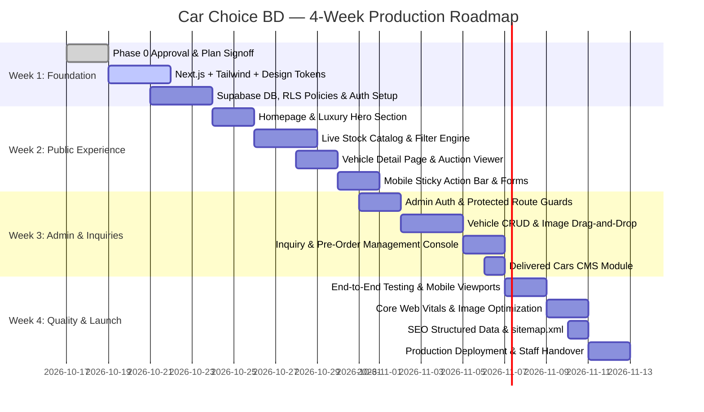

# CAR CHOICE BD — Four-Week Implementation Roadmap & Quality Assurance Plan

> **Document ID:** `CCBD-DOC-06`  
> **Location:** `d:/CarChoice/docs/planning/06-four-week-roadmap-and-quality-plan.md`  
> **Target Delivery Timeframe:** 4 Weeks (28 Calendar Days)  
> **Target Production Launch:** November 2026

---

## 1. Phased Four-Week Delivery Timeline



---

## 2. Weekly Sprint Breakdown & Acceptance Gates

### Week 1: Architecture, Design Tokens & Database Engine
* **Core Deliverables:**
  * Clean Next.js 14+ (App Router) project initialized with TypeScript.
  * Tailwind CSS theme configured with official brand tokens (Midnight Navy, Chrome Silver, Champagne Gold, Crimson Red).
  * Supabase project initialized with PostgreSQL schema (`vehicles`, `vehicle_images`, `inquiries`, `pre_order_requests`, `delivered_cars`).
  * Row Level Security (RLS) policies tested and active.
  * Seed database populated with 6–10 realistic Japanese vehicles (Toyota Harrier, Corolla Cross, Prado, Vezel).
* **Dependencies:** Discovery documents approval; Supabase project creation.
* **What Client Must Supply:** Transparent vector/PNG logo; initial showroom vehicle spec sheets.
* **Acceptance Gate:** Next.js application connects securely to Supabase; public can fetch published test cars via Server Actions.

---

### Week 2: Public Customer Web Experience
* **Core Deliverables:**
  * Fully responsive Homepage (`/`) with Hero fast-search, 4 trust pillars, 6-portal service hub, and Rajshahi showroom anchor.
  * Live Stock Catalog (`/stock`) with instant multi-filtering (Make, Model, Year, Fuel, Auction Grade, Mileage) and Dual-View toggle (Grid / Table).
  * Vehicle Detail Page (`/stock/[slug]`) with multi-photo slider, Japanese auction sheet lightbox, 20+ specifications, and features tag cloud.
  * Direct WhatsApp inquiry action with pre-filled vehicle details and chassis number.
  * Pre-Order Sourcing Page (`/pre-order`) and Auction Sheet Verification Page (`/verify-auction-sheet`).
  * About Us (`/about`), How to Buy (`/how-to-buy`), and Contact (`/contact`) pages.
* **Dependencies:** Week 1 database seed data.
* **Acceptance Gate:** Public customer can search, filter, view complete car details, and trigger WhatsApp leads across desktop and mobile devices.

---

### Week 3: Secure Admin Dashboard & Inquiry Management
* **Core Deliverables:**
  * Admin Login (`/admin/login`) with Supabase Auth and session security guards.
  * Vehicle Management Table (`/admin/vehicles`) with status toggles (`Ready Stock`, `Port`, `Reserved`, `Sold`, `Draft`, `Published`).
  * Vehicle Creation & Editor Form with multi-image drag-and-drop uploader directly into Supabase Storage.
  * Customer Inquiry Manager (`/admin/inquiries`) with status tracking (`New Lead`, `Contacted`, `Closed`) and one-click WhatsApp response buttons.
  * Pre-Order Request Manager (`/admin/pre-orders`).
  * Delivered Cars Manager (`/admin/delivered-cars`).
* **Dependencies:** Supabase Storage bucket configuration.
* **Acceptance Gate:** Showroom staff can log in, upload 15 car photos, edit pricing, and publish a car that immediately appears on the live website.

---

### Week 4: Quality Assurance, SEO, Deployment & Handover
* **Core Deliverables:**
  * Production deployment to **Vercel** with custom domain connection (`carchoicebd.com` / `www.carchoicebd.com`).
  * SSL/HTTPS certificate active with automatic DNS redirection.
  * Automated `sitemap.xml`, `robots.txt`, and Schema.org `Vehicle` JSON-LD structured data for Google Rich Results.
  * Image optimization with automatic WebP conversion and responsive `sizes`.
  * Comprehensive cross-browser and mobile device testing (Chrome, Safari, Firefox, iOS, Android).
  * 1-hour recorded video training & walkthrough manual for showroom staff.
* **Dependencies:** Domain DNS access (Nameservers / CNAME records).
* **Acceptance Gate:** 100% test pass on critical user journeys; Lighthouse Performance score ≥ 90 on Desktop and ≥ 80 on Mobile.

---

## 3. Scope Management & Contingency Plan (What to Cut if Rushed)

If unexpected delays occur (e.g. client delay in supplying photographs or DNS credentials), strict scope boundaries ensure a polished core launch:

| Feature / Task | Status | Contingency Action if Schedule is Tight |
| :--- | :--- | :--- |
| **Ready Stock Catalog & Search** | **P0 (Must Launch)** | **Never Cut:** Core revenue driver. |
| **WhatsApp Direct Lead Action** | **P0 (Must Launch)** | **Never Cut:** Essential conversion path. |
| **Admin Vehicle Creation & Upload** | **P0 (Must Launch)** | **Never Cut:** Enables client self-sufficiency. |
| **Delivered Cars Social Gallery** | **P1 (High)** | Launch with static initial 4 customer delivery cards; defer dynamic admin module by 3 days. |
| **EMI / Bank Loan Calculator** | **P2 (Medium)** | Replace interactive slider with a clean static comparison table of partner bank rates. |
| **Automated bKash Payment Gateway** | **P2 (Deferred)** | Defer to Phase 2; route auction verification requests directly to WhatsApp. |
| **Bangla / English Dual Language Switcher** | **P2 (Deferred)** | Launch with primary bilingual layout (English UI with Bangla assistance captions on verification forms); full i18n locale switching in Phase 2. |

---

## 4. Comprehensive Quality Assurance Plan

### 4.1 Security & Data Integrity Assurance
* **Authentication Protection:** Middleware route matchers enforce redirection for all unauthenticated requests targeting `/admin/*`.
* **Zero Service Key Exposure:** The browser bundle is audited to ensure `SUPABASE_SERVICE_ROLE_KEY` is never referenced in client-side code.
* **Input Sanitation:** All form inputs (Name, Phone, City, Message) are validated using **Zod** schemas before database insertion.
* **Spam Prevention:** Invisible honeypot field (`website_url_hp`) catches 99%+ of automated web spiders without requiring intrusive CAPTCHAs.
* **Database Backups:** Daily automated backups enabled via Supabase cloud dashboard.

### 4.2 Cross-Device & Mobile Viewport Matrix

| Device / Viewport | Target Resolution | Primary Test Focus |
| :--- | :--- | :--- |
| **Large Desktop** | `1440 × 900` / `1920 × 1080` | High-res vehicle imagery, 3-column grid, sticky filter rail, typography tracking. |
| **Laptop** | `1280 × 800` | Navigation menu spacing, data table horizontal fit. |
| **Tablet** | `1024 × 768` (iPad) | Filter drawer slide-over, touch interactions on gallery slider. |
| **Mobile Standard** | `390 × 844` (iPhone 14/15) | Hamburger menu drawer, single-column card readability, persistent bottom bar. |
| **Mobile Compact** | `360 × 740` (Android Entry) | Fast 4G loading, no text truncation, phone dialing touch targets ≥ 48px. |

### 4.3 Search Engine Optimization (SEO) & Social Sharing
1. **Dynamic Open Graph & Twitter Cards:**  
   When a vehicle link (`/stock/toyota-harrier-z-2024`) is shared on WhatsApp or Facebook, the crawler must automatically display:
   * Title: `Toyota Harrier Z Leather Package 2024 | Car Choice BD`
   * Image: High-resolution cover photo of that specific vehicle.
   * Description: `৳ 84,50,000 • 2.5L Hybrid • 12,000 km • Grade 5/A. Available at Car Choice BD Rajshahi.`
2. **Schema.org Structured Data:**  
   Every vehicle page injects valid JSON-LD:
   ```json
   {
     "@context": "https://schema.org/",
     "@type": "Car",
     "name": "Toyota Harrier Z Leather Package",
     "image": "https://carchoicebd.com/...",
     "vehicleIdentificationNumber": "AXUH80-1094821",
     "modelDate": "2024",
     "mileageFromOdometer": "12000 km",
     "vehicleEngine": {
       "@type": "EngineSpecification",
       "fuelType": "Hybrid"
     },
     "offers": {
       "@type": "Offer",
       "priceCurrency": "BDT",
       "price": "8450000",
       "availability": "https://schema.org/InStock",
       "seller": {
         "@type": "AutoDealer",
         "name": "Car Choice BD",
         "address": "Near BRTA Office, Amchattar, Rajshahi, Bangladesh, 6203"
       }
     }
   }
   ```
3. **Core Web Vitals Benchmarks:**
   * **Largest Contentful Paint (LCP):** < 2.0s
   * **First Input Delay (FID) / Interaction to Next Paint (INP):** < 100ms
   * **Cumulative Layout Shift (CLS):** < 0.05
